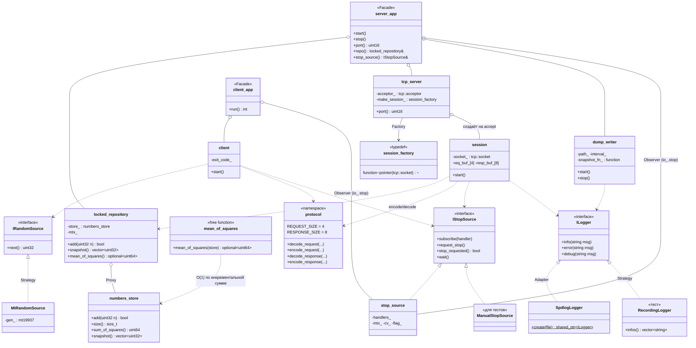
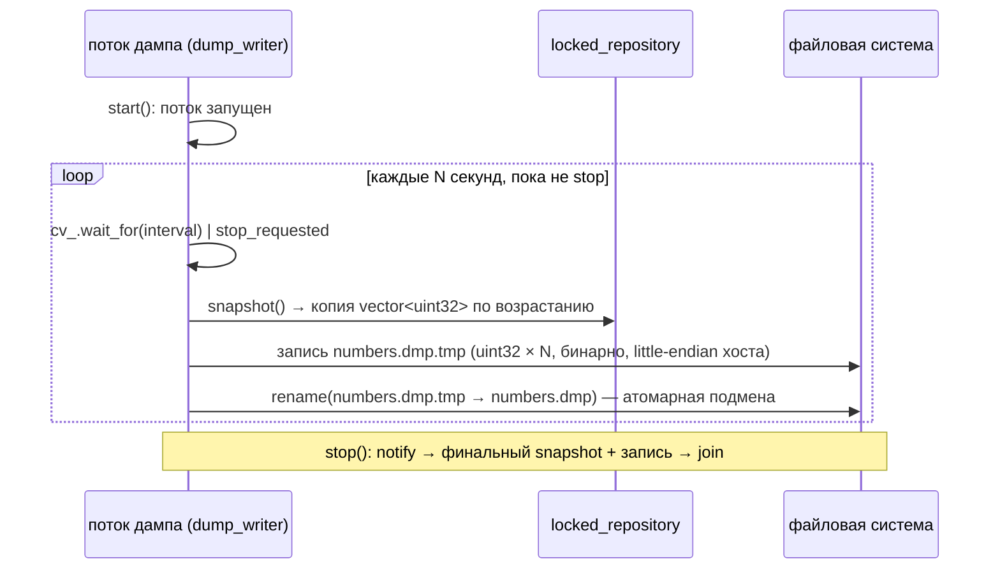
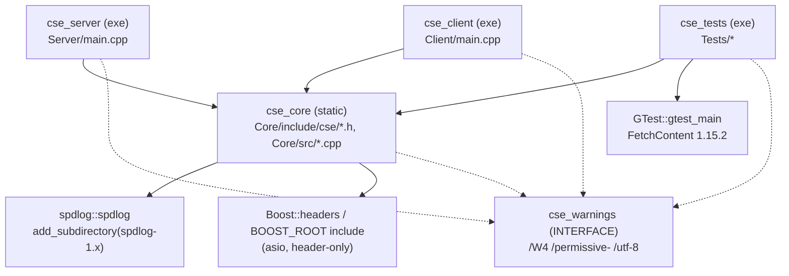

# Задание архитектору: план перевода Client-Server-exchange на CMake + SOLID/DRY/KISS + GoogleTest

Адресат: architect
Дата: 2026-11-17
Ветка: `cmake-refactor` (создана от `boost-1.92`)

## Цель

Превратить утверждённый дизайн (`docs/superpowers/specs/2026-11-17-cmake-refactor-design.md`)
в пошаговый план реализации, по которому разработчик сможет писать код, не принимая
архитектурных решений самостоятельно.

## Входные данные

1. **Design doc (утверждён пользователем, менять решения нельзя):**
   `docs/superpowers/specs/2026-11-17-cmake-refactor-design.md`
   — там: цели/не-цели/анти-цели, поведение по ТЗ (протокол 4/8 байт, глобальное
   хранилище, бинарный `numbers.dmp`, ESC, логи), структура каталогов, таблица
   GoF-паттернов, план проверки T1–T12, команды сборки.
2. **ТЗ:** `TestTask.docx` (текст — в design doc §4, пересказан точно).
3. **Текущий код** (что именно переписывается):
   - `Server/srv.h` — `client_io` с busy-loop 1 мс, очередь соединений, `tcp_server`, `srv_mgr` (синглтон);
   - `Server/connect.h` — `tcp_connection`, `RW_STATUS`, сырые буферы, `code` только для WSAECONNRESET;
   - `Server/SrvAlg.h` — `parallel_queue` (double-buffer), `storage_numbers` (per-connection, хранит квадраты);
   - `Server/dumper.h` — поток дампа, пишет текст квадратов в `N.dmp`;
   - `Client/client.h` — `client`, `client_mgr` (синглтон), `ip::address::from_string`;
   - `Client/clnAlg.h` — `random()`;
   - `Server/main.cpp`, `Client/main.cpp` — `log_instance` + макросы-синглтоны.
4. **Найденные дефекты, которые план обязан закрыть:** per-connection хранилище вместо
   глобального (ТЗ), текст вместо бинарника в дампе (ТЗ), отсутствие проверки размера при
   касте `*(uint32_t*)get_data()`, дублирование read/write-циклов, `parallel_queue`
   с ручным double-buffer, синглтоны по макросам.

## Что сделать

Дописать план в этот же файл ниже раздела «План» (не создавать отдельный документ).
Структура плана — по `superpowers:writing-plans`:

1. **Заголовок**: цель, архитектура в 2–3 предложениях, стек, ссылка на design doc,
   «Global Constraints» (C++20, MSVC x64, Boost 1.92 из `BOOST_ROOT`, spdlog vendored,
   GoogleTest через FetchContent, Windows-only, протокол 4/8 байт, порт 64000,
   интервал дампа 5 с).
2. **Карта файлов**: что создаётся/модифицируется, одна ответственность на файл,
   из `Core/include/cse/*`, `Server/main.cpp`, `Client/main.cpp`, `Tests/*`,
   `CMakeLists.txt`, `cmake/*`.
3. **Диаграммы**:
   - class diagram (PlantUML или ASCII) — все типы ядра, asio-слой, кто кого держит;
   - sequence diagram — путь одного запроса: accept → read 4 → add → mean → write 8 → read;
   - sequence diagram — дамп: таймер/ожидание → snapshot → запись tmp → rename;
   - диаграмма зависимостей CMake-таргетов (core → server/client/tests).
4. **Задачи** (bite-size, TDD: падающий тест → реализация → зелёный тест → коммит).
   Каждая задача — с блоками `Files:` (точные пути), `Interfaces:` (`Consumes`/`Produces`
   с точными сигнатурами), шагами и ожидаемым выводом команд. Порядок: сначала
   `Core` (logger, numbers, mean, protocol, random, options, dump_writer, stop_source),
   затем asio-слой (session, server, client), затем `main`, затем интеграционные тесты,
   затем CMake-обвязка — либо так, как считаешь правильнее; главное, чтобы каждый шаг
   был проверяем командой.
5. **План проверки**: таблица «пункт T1–T12 из design doc → задача, в которой он
   появляется → команда проверки» и отдельно `ctest`-команды. Ни один пункт не теряется.
6. **Риски и порядок**: что делать первым, что можно параллелить, где вероятны проблемы
   (asio-остановка, перекрытие io_context между тестами, `static` порт 64000 в тестах —
   использовать `127.0.0.1:0` и читать фактический порт у acceptor).

## Чего НЕ делать

- Не писать реализацию (никаких готовых .cpp/.h в репозитории) — только план.
- Не менять решения design doc (глобальное хранилище, бинарный `numbers.dmp`,
  pull-модель дампера, набор паттернов, состав таргетов).
- Не трогать и не удалять старые MSBuild-файлы (`*.sln`, `*.vcxproj`, `spdlog-1.x/*`).
- Не «улучшать» протокол (4/8 байт, host order) и не добавлять кроссплатформенность.
- Не предлагать новые зависимости сверх Boost, spdlog, GoogleTest.
- Не коммитить ничего.

## Ожидаемый результат

Один файл: этот (`docs/worklog/plans/2026-11-17-cmake-refactor-arch.md`) с дописанным
планом; задачи пронумерованы, у каждой — файлы, интерфейсы и проверяемые шаги.

## Критерии готовности

- Разработчик может взять задачи по порядку и писать код, не задавая вопросов о
  именах/сигнатурах/путях.
- Каждый пункт T1–T12 имеет задачу и команду проверки.
- Диаграммы присутствуют (class + 2 sequence + CMake-зависимости).
- Ни одной задачи, которая требует правки файлов вне объявленного списка.
- Нет кода реализации — только сигнатуры, тестовые утверждения и шаги проверки.

---

# План

## 0. Цель и архитектура

Переписать Client-Server-exchange на CMake-сборку с ядром без сокетов и консоли
(`cse_core`: хранилище чисел, среднее квадратов, кодек протокола, дампер, логгер,
стоп-источник, генератор, опции), тонким asio-слоем (`session`, `tcp_server`, `client`)
и композицией в `main` — без синглтонов. Поведение по ТЗ: глобальное хранилище
уникальных чисел, среднее квадратов по всем сохранённым, бинарный дамп `numbers.dmp`
каждые N секунд, протокол 4/8 байт, ESC — штатная остановка. Всё покрыто GoogleTest
(юнит-тесты ядра + интеграционные на loopback).

**Стек:** C++20, MSVC x64 (v143), Boost 1.92 (только заголовки, `BOOST_ROOT`),
spdlog (vendored `spdlog-1.x/`), GoogleTest 1.15.2 (FetchContent).

**Design doc (решения менять нельзя):** `docs/superpowers/specs/2026-11-17-cmake-refactor-design.md`

### Global Constraints

- Стандарт C++20; флаги `/W4 /permissive- /utf-8` через `cse_warnings` INTERFACE-таргет.
- Windows-only: `conio.h` разрешён **только** в `Server/main.cpp` / `Client/main.cpp`.
- Boost: cache-переменная `BOOST_ROOT` (дефолт `D:/libs/boost_1_92_0`); только заголовки —
  `find_package(Boost CONFIG QUIET)` → `Boost::headers`, иначе include-путь `${BOOST_ROOT}`.
- spdlog: `add_subdirectory(spdlog-1.x)` с выключенными примерами/бенчмарками/тестами;
  НЕ использовать глобальный реестр spdlog (`spdlog::register_logger` не звать) —
  иначе тесты с двумя логгерами collide.
- GoogleTest: FetchContent v1.15.2, опция `-DCSE_USE_SYSTEM_GTEST=ON` → `find_package(GTest)`.
- Протокол: запрос `uint32` (4 байта), ответ `uint64` (8 байт), host order, `memcpy`
  фиксированной ширины, port 64000.
- Дамп: `numbers.dmp`, бинарные `uint32` по возрастанию, интервал по умолчанию 5 с,
  запись tmp → rename, отдельный поток, pull-модель (дампер сам тянет `snapshot()`).
- Никаких синглтонов, никакого `sleep_for`/polling в рабочих циклах: клиент темпируется
  roundtrip'ом, дампер спит на `condition_variable`, main блокируется в `_getch()`.
- Тесты не используют порт 64000: только `127.0.0.1:0` + чтение фактического порта у acceptor.
- Ни одна задача не трогает: `*.sln`, `*.vcxproj*`, `Server/server.cpp`, `Server/*.h` (старые),
  `Client/Client.cpp`, `Client/*.h` (старые), `spdlog-1.x/*` (кроме подключения через CMake).
- Коммит после каждой задачи: `git add <файлы задачи> && git commit -m "<сообщение>"`.

## 1. Карта файлов

### Создаётся

| Файл | Ответственность |
|---|---|
| `CMakeLists.txt` | корень: проект, C++20, опции, подключение `cmake/`, `Core/`, `Tests/`, exe-таргеты `cse_server`/`cse_client` |
| `cmake/CompilerWarnings.cmake` | INTERFACE-таргет `cse_warnings` с флагами MSVC |
| `Core/CMakeLists.txt` | таргет `cse_core` (INTERFACE на каркасе → STATIC с задачи 2), ссылки на spdlog/Boost |
| `Core/include/cse/logger.h` | `ILogger` + `SpdlogLogger` (Adapter над spdlog) |
| `Core/src/logger.cpp` | реализация `SpdlogLogger::create` (сборка sink'ов) |
| `Core/include/cse/numbers.h` | `numbers_store` (данные, SRP) + `locked_repository` (Proxy, потокобезопасность) |
| `Core/include/cse/mean_of_squares.h` | свободная функция `mean_of_squares(const numbers_store&)` |
| `Core/include/cse/protocol.h` | кодек запроса/ответа, константы размеров, bounds check |
| `Core/include/cse/random_source.h` | `IRandomSource` + `MtRandomSource` (Strategy) |
| `Core/include/cse/stop_source.h` | `IStopSource` + `stop_source` (Observer: broadcast + блокирующее `wait()`) + `ManualStopSource` |
| `Core/include/cse/options.h` | `options::parse(argc, argv)` — host/port/dump-interval |
| `Core/include/cse/dump_writer.h` | поток дампа: pull snapshot по cv-таймеру, tmp → rename |
| `Core/src/dump_writer.cpp` | реализация потока дампа |
| `Core/include/cse/session.h` | asio-сессия: read 4 → add → mean → write 8 → read … |
| `Core/include/cse/server.h` | `tcp_server` (acceptor + Factory) + `server_app` (Facade) |
| `Core/include/cse/client.h` | `client` (asio-работник) + `client_app` (Facade) |
| `Server/main.cpp` | композиция сервера: options → logger → server_app → ESC → stop |
| `Client/main.cpp` | композиция клиента: options → logger → client_app → ESC → stop |
| `Tests/CMakeLists.txt` | `cse_tests`, FetchContent(GTest), CTest-регистрация |
| `Tests/smoke_test.cpp` | канарейка сборки CTest (SUCCEED) |
| `Tests/support/test_support.h` | `RecordingLogger`, `SequentialRandomSource`, `test_client`, `make_temp_dir`, `make_loopback_pair` |
| `Tests/numbers_store_test.cpp` | T1 |
| `Tests/mean_of_squares_test.cpp` | T2 |
| `Tests/locked_repository_test.cpp` | T3 |
| `Tests/protocol_test.cpp` | T4 |
| `Tests/dump_writer_test.cpp` | T5 |
| `Tests/random_source_test.cpp` | T6 |
| `Tests/options_test.cpp` | T7 |
| `Tests/logger_test.cpp` | T8 |
| `Tests/stop_source_test.cpp` | тесты stop_source (поддержка T11/T12) |
| `Tests/session_test.cpp` | юнит-тест сессии на loopback-паре сокетов |
| `Tests/integration_server_test.cpp` | T9, T10, T11 |
| `Tests/integration_client_test.cpp` | T12 |
| `.gitignore` | дополнить: `build/`, `*.dmp`, `*.log`; старые записи не удалять |

### Не трогается (старый MSBuild-мир)

`ClientServerExchange.sln`, `Server/Server.vcxproj*`, `Client/Client.vcxproj*`,
`Server/server.cpp`, `Server/{srv,connect,SrvAlg,dumper,logger}.h`,
`Client/Client.cpp`, `Client/{client,clnAlg,logger}.h`, `spdlog-1.x/**`.

## 2. Диаграммы

### 2.1 Class diagram — ядро и asio-слой



### 2.2 Sequence — путь одного запроса

```mermaid
sequenceDiagram
    participant К as клиент (client_app)
    participant A as tcp_server (acceptor)
    participant S as session
    participant R as locked_repository
    participant M as mean_of_squares

    К->>A: connect(127.0.0.1, port)
    A->>S: make_session(socket)→start()
    S->>S: async_read(req_buf_, 4 байта)
    К->>S: uint32 число (protocol::encode_request)
    S->>R: add(n)
    R->>R: store_.add(n) под мьютексом<br/>(дубликат → false, сумма не меняется)
    S->>M: mean_of_squares(store) — O(1)
    M-->>S: optional<uint64> (по всем числам сервера)
    S->>S: protocol::encode_response → resp_buf_[8]
    S-->>К: async_write 8 байт
    К->>К: protocol::decode_response, лог "client read number"
    К->>S: следующее число (цикл темпируется roundtrip'ом)
    Note over S: ошибка сокета → закрытие сессии без крэша;<br/>stop_requested → тихий выход (operation_aborted)
```

### 2.3 Sequence — дамп



### 2.4 Зависимости CMake-таргетов



## 3. Задачи

Порядок: каркас → ядро (T1–T8 + stop_source) → asio-слой → main.
Каждая задача: падающий тест → реализация → зелёный тест → коммит.
Все команды выполняются из корня репозитория, конфигурация Release.

Базовые команды (далее «**сборка**» и «**тесты**»):

```
cmake -S . -B build -G "Visual Studio 17 2022" -A x64 -DBOOST_ROOT=D:/libs/boost_1_92_0
cmake --build build --config Release
ctest --test-dir build -C Release --output-on-failure
```

---

### Задача 1. Каркас CMake + smoke-тест

**Files:**
- создать `CMakeLists.txt`
- создать `cmake/CompilerWarnings.cmake`
- создать `Core/CMakeLists.txt` (пока `cse_core` **INTERFACE** — станет STATIC в задаче 2)
- создать `Tests/CMakeLists.txt`, `Tests/smoke_test.cpp`
- создать/дополнить `.gitignore`

**Interfaces:** нет продуктовых. Consumes: `spdlog-1.x/` (add_subdirectory), FetchContent gtest v1.15.2.

**Steps:**
1. Root `CMakeLists.txt`: `cmake_minimum_required(3.20)`, `project(ClientServerExchange CXX)`,
   опция `CSE_USE_SYSTEM_GTEST` (OFF), cache `BOOST_ROOT` (дефолт `D:/libs/boost_1_92_0`),
   `set(CMAKE_CXX_STANDARD 20 REQUIRED)`, `include(cmake/CompilerWarnings.cmake)`,
   `add_subdirectory(spdlog-1.x)` c `SPDLOG_BUILD_EXAMPLES/TESTS/BENCH OFF`,
   `add_subdirectory(Core)`, `add_subdirectory(Tests)`.
   Exe-таргеты `cse_server`/`cse_client` здесь **не добавлять** — исходников main ещё нет
   (появятся в задаче 14). `enable_testing()` — в `Tests/CMakeLists.txt`.
2. `cmake/CompilerWarnings.cmake`: `add_library(cse_warnings INTERFACE)`; для MSVC:
   `/W4 /permissive- /utf-8`.
3. `Core/CMakeLists.txt`: `add_library(cse_core INTERFACE)`;
   `target_include_directories(cse_core INTERFACE Core/include)`;
   Boost: `find_package(Boost CONFIG QUIET)` → `target_link_libraries(... INTERFACE Boost::headers)`,
   при промахе → `target_include_directories(... INTERFACE ${BOOST_ROOT})`;
   spdlog подключится в задаче 2 (исходников spdlog-зависимых ещё нет).
4. `Tests/CMakeLists.txt`: FetchContent(`googletest`, URL
   `https://github.com/google/googletest/releases/download/v1.15.2/googletest-1.15.2.zip`,
   `set(gtest_force_shared_crt ON)`); при `CSE_USE_SYSTEM_GTEST` — `find_package(GTest REQUIRED)`;
   `add_executable(cse_tests smoke_test.cpp)` + `gtest_discover_tests(cse_tests)`.
5. `Tests/smoke_test.cpp`: `TEST(smoke, gtest_wired) { SUCCEED(); }` — канарейка, остаётся.

**Проверка:** «сборка» проходит без ошибок конфигурации; «тесты» → `1 test passed (smoke.gtest_wired)`.
**Commit:** `git add CMakeLists.txt cmake Core Tests .gitignore && git commit -m "build: cmake skeleton, cse_core interface, gtest smoke"`

---

### Задача 2. `ILogger` + `SpdlogLogger` (T8)

**Files:** `Core/include/cse/logger.h` (new), `Core/src/logger.cpp` (new),
`Core/CMakeLists.txt` (cse_core → STATIC + `Core/src/logger.cpp` + link `spdlog::spdlog`),
`Tests/logger_test.cpp` (new), `Tests/CMakeLists.txt` (добавить исходник).

**Interfaces:**
- Produces:
  ```cpp
  namespace cse {
  class ILogger {
  public:
      virtual ~ILogger() = default;
      virtual void info(const std::string& msg) = 0;
      virtual void error(const std::string& msg) = 0;
      virtual void debug(const std::string& msg) = 0;
  };
  class SpdlogLogger final : public ILogger {
  public:
      // консоль (wincolor) + rotating file, pattern "%D %H:%M:%S.%e %05t %05l %v",
      // уровень info; НЕ регистрировать в реестре spdlog
      static std::shared_ptr<ILogger> create(const std::string& file_path);
  };
  }
  ```

**Steps (TDD):**
1. Тест (падает — заголовка нет): создать логгер `SpdlogLogger::create(временный файл)`;
   `info("hello")` → файл существует и содержит `hello`; `debug("dbg")` → в файле **нет**
   (уровень info фильтрует); `error("oops")` → содержится.
2. Реализация `logger.h`/`logger.cpp`; `cse_core` → STATIC.
3. Тесты зелёные.

**Проверка:** `ctest --test-dir build -C Release -R Logger --output-on-failure` → passed.
**Commit:** `git add Core Tests && git commit -m "core: ILogger + SpdlogLogger adapter (T8)"`

---

### Задача 3. `numbers_store` (T1)

**Files:** `Core/include/cse/numbers.h` (new), `Tests/numbers_store_test.cpp` (new),
`Tests/CMakeLists.txt` (добавить исходник).

**Interfaces:**
- Produces:
  ```cpp
  namespace cse {
  class numbers_store {          // только данные, однопоточный; потокобезопасность — в Proxy
  public:
      bool add(uint32_t number); // true, если число новое; сумма квадратов обновляется только при true
      size_t size() const;
      uint64_t sum_of_squares() const;         // инкрементально поддерживаемая сумма
      std::vector<uint32_t> snapshot() const;  // по возрастанию
  };
  }
  ```

**Steps (TDD):**
1. Тест: пусто → size 0, sum 0, snapshot пуст; `add(5)` → true, sum 25;
   `add(5)` повторно → false, sum по-прежнему 25, size 1; `add(0)`, `add(1023)` → границы;
   snapshot отсортирован по возрастанию (add 7, 5, 0 → snapshot `{0, 5, 7}`).
2. Реализация: `std::set<uint32_t>` + `uint64_t sum_` (квадрат считать `uint64_t(n) * n`).
3. Тесты зелёные.

**Проверка:** `ctest --test-dir build -C Release -R NumbersStore --output-on-failure` → passed.
**Commit:** `git add Core Tests && git commit -m "core: numbers_store, duplicates ignored, incremental sum (T1)"`

---

### Задача 4. `mean_of_squares` (T2)

**Files:** `Core/include/cse/mean_of_squares.h` (new), `Tests/mean_of_squares_test.cpp` (new).

**Interfaces:**
- Consumes: `cse::numbers_store`.
- Produces:
  ```cpp
  namespace cse {
  // пусто → nullopt; иначе sum_of_squares() / size(); переполнения нет (uint64)
  std::optional<uint64_t> mean_of_squares(const numbers_store& store);
  }
  ```

**Steps (TDD):**
1. Тест: пусто → nullopt; `{0}` → 0; `{1023}` → 1046529; полный набор 1..1023 →
   ожидаемое считается в тесте в `uint64` (без хардкода магического числа);
   «дубликат не влияет»: add 5, add 5 (false), add 7 → mean == (25+49)/2 == 37.
2. Реализация: тривиальная функция над store.
3. Тесты зелёные.

**Проверка:** `ctest --test-dir build -C Release -R MeanOfSquares --output-on-failure` → passed.
**Commit:** `git add Core Tests && git commit -m "core: mean_of_squares free function (T2)"`

---

### Задача 5. `locked_repository` (T3)

**Files:** `Core/include/cse/numbers.h` (дополняется), `Tests/locked_repository_test.cpp` (new),
`Tests/support/test_support.h` (new: пока `make_temp_dir`; `RecordingLogger` и
`SequentialRandomSource` добавляются по мере нужды в задачах 12–13).

**Interfaces:**
- Produces (в `numbers.h`):
  ```cpp
  namespace cse {
  class locked_repository {      // Proxy над numbers_store; владеет мьютексом
  public:
      bool add(uint32_t number);
      std::vector<uint32_t> snapshot();            // копия под локом (Iterator)
      std::optional<uint64_t> mean_of_squares();   // O(1), под локом
      // без доступа к голому store снаружи
  };
  }
  ```
  Оговорка: в диаграмме design doc имя «numbers_repository» обозначает именно этот
  Proxy-класс; класс данных называется `numbers_store` — разночтение между §5 и §6
  design разрешается такой парой имён (решение внутри рамок design, не против него).

**Steps (TDD):**
1. Тест: 8 потоков × 1000 `add`, поток t добавляет значения `(t*128 + i) % 1024`
   (пересечение диапазонов даёт дубликаты); после join: size == число уникальных
   (посчитать в тесте из тех же данных), mean == пересчитанное по snapshot.
   Отдельный тест: одновременные add + snapshot из другого потока — smoke на
   отсутствие дедлока/крэша.
2. Реализация: `std::mutex` + делегирование в `numbers_store`.
3. Тесты зелёные.

**Проверка:** `ctest --test-dir build -C Release -R LockedRepository --output-on-failure` → passed.
**Commit:** `git add Core Tests && git commit -m "core: locked_repository proxy, 8-thread stress (T3)"`

---

### Задача 6. `protocol` (T4)

**Files:** `Core/include/cse/protocol.h` (new), `Tests/protocol_test.cpp` (new).

**Interfaces:**
- Produces:
  ```cpp
  namespace cse::protocol {
  inline constexpr size_t REQUEST_SIZE  = 4;
  inline constexpr size_t RESPONSE_SIZE = 8;
  bool decode_request (const uint8_t* data, size_t size, uint32_t& out); // false при size != 4
  size_t encode_request (uint32_t number, uint8_t* out);                 // пишет 4 байта, возвращает 4
  bool decode_response(const uint8_t* data, size_t size, uint64_t& out); // false при size != 8
  size_t encode_response(uint64_t mean,  uint8_t* out);                  // пишет 8 байт, возвращает 8
  }
  ```
  Порядок байт — host, запись через `memcpy` фиксированной ширины (как в текущем коде).

**Steps (TDD):**
1. Тест: `encode_request(1)` → байты `{1,0,0,0}`; `encode_request(0x10230405)` → roundtrip
   `decode_request` → исходное; `decode_request(buf, 3)` и `(buf, 5)` → false;
   то же для response: `encode_response(37)` → `{37,0,...,0}`, roundtrip, размер != 8 → false.
2. Реализация.
3. Тесты зелёные.

**Проверка:** `ctest --test-dir build -C Release -R Protocol --output-on-failure` → passed.
**Commit:** `git add Core Tests && git commit -m "core: protocol codec with size checks (T4)"`

---

### Задача 7. `random_source` (T6)

**Files:** `Core/include/cse/random_source.h` (new), `Tests/random_source_test.cpp` (new).

**Interfaces:**
- Produces:
  ```cpp
  namespace cse {
  class IRandomSource {
  public:
      virtual ~IRandomSource() = default;
      virtual uint32_t next() = 0;   // число 0..1023
  };
  class MtRandomSource final : public IRandomSource {
  public:
      explicit MtRandomSource(uint32_t seed = std::random_device{}());
      uint32_t next() override;      // std::uniform_int_distribution<uint32_t>(0, 1023)
  };
  }
  ```

**Steps (TDD):**
1. Тест: два `MtRandomSource(42)` дают одинаковые первые 100 значений (детерминизм);
   10 000 значений → все в [0, 1023]. (Точные значения не хардкодить — зависят от
   реализации stdlib; детерминизм + диапазон достаточно.)
2. Реализация: member `std::mt19937`, сид фиксируется конструктором (Strategy: тесты
   подставят свою реализацию — `SequentialRandomSource` в `test_support.h`).
3. Тесты зелёные.

**Проверка:** `ctest --test-dir build -C Release -R RandomSource --output-on-failure` → passed.
**Commit:** `git add Core Tests && git commit -m "core: IRandomSource + MtRandomSource (T6)"`

---

### Задача 8. `stop_source` (Observer; поддержка T11/T12)

**Files:** `Core/include/cse/stop_source.h` (new), `Tests/stop_source_test.cpp` (new).

**Interfaces:**
- Produces:
  ```cpp
  namespace cse {
  class IStopSource {
  public:
      virtual ~IStopSource() = default;
      virtual void subscribe(std::function<void()> handler) = 0; // Observer
      virtual void request_stop() = 0;                            // идемпотентно, один broadcast
      virtual bool stop_requested() const = 0;
      virtual void wait() const = 0;   // блокирует поток до request_stop (без sleep-поллинга)
  };
  class stop_source final : public IStopSource;      // подписка после stop → handler зовётся сразу
  class ManualStopSource final : public IStopSource; // тестовый: тест сам дергает request_stop()
  }
  ```

**Steps (TDD):**
1. Тест: подписчик вызван ровно один раз при двойном `request_stop()`; `wait()` из
   другого потока разблокируется после `request_stop()` (promise/future); после stop
   `stop_requested()` == true; подписка после stop → handler выполнен немедленно.
2. Реализация: `std::mutex` + `std::condition_variable` + `std::atomic_bool`;
   идемпотентность через флаг (повторный request_stop не рассылает повторно).
3. Тесты зелёные.

**Проверка:** `ctest --test-dir build -C Release -R StopSource --output-on-failure` → passed.
**Commit:** `git add Core Tests && git commit -m "core: stop_source observer with blocking wait"`

---

### Задача 9. `options` (T7)

**Files:** `Core/include/cse/options.h` (new), `Tests/options_test.cpp` (new).

**Interfaces:**
- Produces:
  ```cpp
  namespace cse {
  struct options {
      std::string host{"127.0.0.1"};         // клиент
      uint16_t port{64000};                  // сервер и клиент
      std::chrono::seconds dump_interval{5}; // сервер
      // parse пропускает argv[0]; неизвестный флаг / нечисловое значение /
      // вне диапазона uint16 → nullopt
      static std::optional<options> parse(int argc, char* argv[]);
  };
  }
  ```

**Steps (TDD):**
1. Тест: без аргументов → дефолты (64000, 5s, "127.0.0.1"); `--port 7000` → 7000;
   `--dump-interval 10` → 10s; `--host 1.2.3.4`; `--port abc` → nullopt; `--port 70000`
   → nullopt; `--unknown` → nullopt; `--port` без значения → nullopt.
2. Реализация (простой цикл по argv, `std::from_chars`).
3. Тесты зелёные.

**Проверка:** `ctest --test-dir build -C Release -R Options --output-on-failure` → passed.
**Commit:** `git add Core Tests && git commit -m "core: options parsing (T7)"`

---

### Задача 10. `dump_writer` (T5)

**Files:** `Core/include/cse/dump_writer.h` (new), `Core/src/dump_writer.cpp` (new),
`Tests/dump_writer_test.cpp` (new), `Core/CMakeLists.txt` (добавить исходник).

**Interfaces:**
- Consumes: `std::function<std::vector<uint32_t>()>` (источник snapshot — обычно
  `locked_repository::snapshot`, инжектится, чтобы дампер не знал про хранилище),
  `ILogger&`.
- Produces:
  ```cpp
  namespace cse {
  class dump_writer {
  public:
      // interval — период дампа; file — итоговый путь numbers.dmp
      dump_writer(std::filesystem::path file, std::chrono::seconds interval,
                  std::function<std::vector<uint32_t>()> snapshot_fn, ILogger& log);
      void start();         // запуск потока
      void stop();          // notify → финальный snapshot + запись → join
  private:
      void run();           // cv_.wait_for(interval) | stop → snapshot → write_once()
      void write_once();    // numbers.dmp.tmp → rename (fallback: remove + rename)
  };
  }
  ```

**Steps (TDD):**
1. Тесты (interval = 100ms, snapshot_fn = лямбда над локальным `numbers_store`):
   - после ~300ms файл существует, размер == N*4, содержимое == snapshot по возрастанию
     (читать `uint32` через `ifstream.read`);
   - мутировали store → следующий дамп перезаписал файл (новое содержимое);
   - `stop()` завершает поток < 1 с (без зависимости от интервала ожидания);
   - пустой snapshot → файл существует, 0 байт;
   - tmp-файла `numbers.dmp.tmp` после дампа не остаётся.
2. Реализация: поток + `condition_variable::wait_for`; запись `std::ofstream` binary;
   `std::filesystem::rename` (MSVC перезаписывает целевой файл; fallback —
   `remove(target)` перед rename, одной строкой).
3. Тесты зелёные.

**Проверка:** `ctest --test-dir build -C Release -R DumpWriter --output-on-failure` → passed.
**Commit:** `git add Core Tests && git commit -m "core: dump_writer, binary tmp+rename, pull model (T5)"`

---

### Задача 11. `session` + `session_factory` (юнит на loopback)

**Files:** `Core/include/cse/session.h` (new), `Tests/session_test.cpp` (new),
`Tests/support/test_support.h` (добавить `make_loopback_pair()`).

**Interfaces:**
- Consumes: `locked_repository`, `ILogger`, `IStopSource`, `cse::protocol`.
- Produces:
  ```cpp
  namespace cse {
  class session : public std::enable_shared_from_this<session> {
  public:
      using pointer = std::shared_ptr<session>;
      session(boost::asio::ip::tcp::socket socket,
              locked_repository& repo, ILogger& log, IStopSource& stop);
      void start();     // async_read 4 → add → encode_response(mean) → async_write 8 → снова read
  private:
      void do_read();  void on_read(const boost::system::error_code&, size_t);
      void do_write(); void on_write(const boost::system::error_code&, size_t);
      uint8_t req_buf_[protocol::REQUEST_SIZE]{};
      uint8_t resp_buf_[protocol::RESPONSE_SIZE]{};
  };
  using session_factory = std::function<session::pointer(boost::asio::ip::tcp::socket)>;
  }
  ```

**Steps (TDD):**
1. `make_loopback_pair()` в `test_support.h`: acceptor на `127.0.0.1:0`, один accept +
   один connect → пара соединённых сокетов.
2. Тест: io_context + `make_work_guard` в отдельном потоке; серверный сокет → `session`;
   клиентский: `encode_request(7)` → write → read 8 → `decode_response` == 49;
   повтор `7` → снова 49 (дубликат не меняет среднее); закрыть клиентский сокет →
   сессия завершается, io_context останавливается без висящих хендлеров;
   отдельный тест: клиент шлёт 2 байта и закрывает сокет → сессия заканчивается
   тихо (ошибка → закрытие, без крэша и бесконечного цикла).
3. Реализация: async-цепочка; при ошибке/`stop_requested()` — выход из цикла (никаких
   повторных async_read после закрытия).
4. Тесты зелёные.

**Проверка:** `ctest --test-dir build -C Release -R Session --output-on-failure` → passed.
**Commit:** `git add Core Tests && git commit -m "core: asio session, read4-add-write8 loop"`

---

### Задача 12. `tcp_server` + `server_app` (T9, T10, T11)

**Files:** `Core/include/cse/server.h` (new), `Tests/integration_server_test.cpp` (new),
`Tests/support/test_support.h` (добавить `test_client`).

**Interfaces:**
- Consumes: `session_factory`, `locked_repository`, `dump_writer`, `stop_source`,
  `ILogger`, `options`.
- Produces:
  ```cpp
  namespace cse {
  session_factory make_session_factory(locked_repository& repo, ILogger& log, IStopSource& stop);

  class tcp_server {
  public:
      // bind происходит в конструкторе: занятый порт → исключение конструктора
      tcp_server(boost::asio::io_context& io, uint16_t port,
                 session_factory make_session, ILogger& log);
      uint16_t port() const;   // фактический порт (local_endpoint) — для тестов с портом 0
  };

  class server_app {           // Facade: владеет всем, main зовёт только start/stop
  public:
      server_app(uint16_t port, std::chrono::seconds dump_interval,
                 std::filesystem::path dump_file, ILogger& log);
      void start();            // dumper_.start() + поток io_.run()
      void stop();             // stop_.request_stop() → io_thread_.join() → dumper_.stop()
      uint16_t port() const;
      locked_repository& repo();      // для проверок тестов
      IStopSource& stop_source();     // ESC из main
  };
  }
  ```
  Порядок членов (важен для разрушения): `repo_`, `stop_`, `io_`, `server_`, `dumper_`,
  `io_thread_`. Подписчик `stop_`: `[this]{ io_.stop(); }` — остановка asio через Observer.

**Steps (TDD):**
1. `test_client` в `test_support.h`: синхронный asio-клиент (`connect(127.0.0.1, port)`,
   `send(uint32)` через `protocol::encode_request` + write, `read_mean()` = read 8 +
   `decode_response`, `close()`).
2. Тесты:
   - **T9**: `server_app app(0, 1s, tmp/"numbers.dmp", logger)`; `app.start()`;
     клиент шлёт 5 → mean 25; шлёт 5 → 25; шлёт 7 → 37; `app.repo().size()` == 2;
     `app.stop()` — быстрый, без deadlock.
   - **T10**: второй `test_client` шлёт 100 → следующий ответ первого клиента
     учитывает 10000 (глобальность хранилища).
   - **T11**: при подключённом клиенте `app.stop()` → клиентский `read_mean()` вернёт
     ошибку/EOF не позже 2 с (мерить `steady_clock`), поток io завершён.
3. Реализация: `tcp_server` с `async_accept` + `make_session_` (Factory); acceptor
   создаётся в конструкторе `server_app`.
4. Тесты зелёные.

**Проверка:** `ctest --test-dir build -C Release -R IntegrationServer --output-on-failure` → passed.
**Commit:** `git add Core Tests && git commit -m "core: tcp_server + server_app facade (T9-T11)"`

---

### Задача 13. `client` + `client_app` (T12)

**Files:** `Core/include/cse/client.h` (new), `Tests/integration_client_test.cpp` (new).

**Interfaces:**
- Consumes: `IRandomSource`, `ILogger`, `IStopSource`, `cse::protocol`.
- Produces:
  ```cpp
  namespace cse {
  class client {   // asio-работник: async_connect (3 попытки) → цикл write4/read8
  public:
      client(boost::asio::io_context& io, std::string host, uint16_t port,
             IRandomSource& rnd, ILogger& log, IStopSource& stop);
      void start();
      int exit_code() const;   // 0 — штатная остановка; 1 — сервер недоступен (3 неудачи)
  };

  class client_app {           // Facade
  public:
      client_app(const options& opts, IRandomSource& rnd, ILogger& log);
      int run();               // блокирующий: io_.run() до остановки/исчерпания попыток
      void request_stop();     // для тестов; в main вызывает stop_source
  };
  }
  ```
  Поведение цикла: число → лог `client send number:N` → write 4 → read 8 → лог
  `client read number:M` → следующее число; пауз нет — темп задаёт roundtrip
  (анти-цель «sleep-поллинг» соблюдена). Ошибка в сессии = разрыв → переподключение,
  общий счётчик попыток 3 (не `static`, в отличие от старого кода).

**Steps (TDD):**
1. Тесты:
   - **T12**: закрытый порт (acceptor подняли и сразу закрыли) →
     `client_app::run()` возвращает 1 за < 5 с, попыток ровно 3 (RecordingLogger
     насчитал 3 connect-ошибок), ничего не висит.
   - интеграционный: против `server_app` из задачи 12 → ответы корректны, `run()`
     останавливается `request_stop()` < 2 с (exit_code 0).
2. Реализация: async_connect с ретраем; подписчик `stop_` на `io_.stop()` (Observer);
   закрытие сокета при остановке.
3. Тесты зелёные.

**Проверка:** `ctest --test-dir build -C Release -R IntegrationClient --output-on-failure` → passed.
**Commit:** `git add Core Tests && git commit -m "core: client with 3 connect attempts (T12)"`

---

### Задача 14. `main`-ы + ручная сквозная проверка

**Files:** `Server/main.cpp` (new), `Client/main.cpp` (new),
`CMakeLists.txt` (добавить exe-таргеты `cse_server`, `cse_client`).

**Interfaces:**
- Consumes: `options::parse`, `SpdlogLogger::create`, `server_app` / `client_app`,
  `IStopSource::request_stop`.
- Схема обоих main (композиция, без синглтонов; `conio.h` — только здесь):
  1. `options::parse(argc, argv)` → при nullopt: usage в stderr, return 2.
  2. `SpdlogLogger::create("server.log" / "client.log")`.
  3. Сервер: `server_app(opts.port, opts.dump_interval, "numbers.dmp", *logger)` →
     `start()` → лог `start server` → блокирующий `_getch() == 27` (ESC, без busy-loop) →
     `stop_source.request_stop()` → `stop()` → лог `stop server`.
     Клиент: `stop_source` создан в main; `std::thread` с `app.run()` (результат в
     `code`); main блокируется в `_getch() == 27` → `stop_.request_stop()` →
     `join()` → `return code`. ESC — единственный штатный выход, как в ТЗ.
  4. Сервер: `return 0`; клиент: `return code`.

**Steps:**
1. Добавить exe-таргеты в root `CMakeLists.txt` (`cse_server` ← `Server/main.cpp`,
   `cse_client` ← `Client/main.cpp`, оба link `cse_core` + `cse_warnings`).
2. Написать main-ы по схеме выше.
3. «Сборка» → оба exe собраны в `build/Release/`.
4. Ручная сквозная проверка (вне CTest, по ТЗ): запустить `cse_server.exe` и
   `cse_client.exe` (порт 64000): в `server.log`/`client.log` обмен числами в прежнем
   формате строк; в каталоге сервера появляется `numbers.dmp`, размер кратен 4;
   повторный запуск сервера перезаписывает дамп; ESC останавливает обоих штатно
   (в логах `stop server` / `client end`).
5. Полный «тесты» → все suites passed.
**Commit:** `git add Server/main.cpp Client/main.cpp CMakeLists.txt && git commit -m "main: composition roots, escape stop"`

## 4. План проверки

### Таблица T1–T12

| ID | Что проверяем | Задача | Команда (из корня) |
|---|---|---|---|
| T1 | дубликаты, размер, сумма квадратов | 3 | `ctest --test-dir build -C Release -R NumbersStore --output-on-failure` |
| T2 | mean: пусто/0/1023/1..1023 | 4 | `ctest --test-dir build -C Release -R MeanOfSquares --output-on-failure` |
| T3 | Proxy: 8×1000 adds, без потерь | 5 | `ctest --test-dir build -C Release -R LockedRepository --output-on-failure` |
| T4 | кодек 4/8 байт, roundtrip, отказ по размеру | 6 | `ctest --test-dir build -C Release -R Protocol --output-on-failure` |
| T5 | дамп N*4 байт, порядок, перезапись, stop | 10 | `ctest --test-dir build -C Release -R DumpWriter --output-on-failure` |
| T6 | детерминизм seed 42, диапазон 0..1023 | 7 | `ctest --test-dir build -C Release -R RandomSource --output-on-failure` |
| T7 | дефолты, --port, --dump-interval, ошибки | 9 | `ctest --test-dir build -C Release -R Options --output-on-failure` |
| T8 | ILogger пишет в файл, уровень фильтрует | 2 | `ctest --test-dir build -C Release -R Logger --output-on-failure` |
| T9 | 1 клиент, глобальное хранилище, дубликат | 12 | `ctest --test-dir build -C Release -R IntegrationServer --output-on-failure` |
| T10 | 2 клиента видят общие числа | 12 | `ctest --test-dir build -C Release -R IntegrationServer --output-on-failure` |
| T11 | stop < 2 с при живом клиенте | 12 | `ctest --test-dir build -C Release -R IntegrationServer --output-on-failure` |
| T12 | 3 попытки → выход с ошибкой, не вечный цикл | 13 | `ctest --test-dir build -C Release -R IntegrationClient --output-on-failure` |

### Полные команды

```
cmake -S . -B build -G "Visual Studio 17 2022" -A x64 -DBOOST_ROOT=D:/libs/boost_1_92_0
cmake --build build --config Release
ctest --test-dir build -C Release --output-on-failure
```

Ожидаемый итог: 13 test suites (smoke, Logger, NumbersStore, MeanOfSquares,
LockedRepository, Protocol, RandomSource, StopSource, Options, DumpWriter, Session,
IntegrationServer, IntegrationClient) — все passed; каждый пункт T1–T12 имеет
задачу и команду.

### Ручная сквозная (вне CTest, задача 14)

1 сервер + ≥2 клиента, 10–20 минут: `numbers.dmp` кратен 4 и перезаписывается,
`server.log`/`client.log` в прежнем формате, память не растёт, ESC останавливает всё штатно.

## 5. Риски и порядок

**Что первым:** задачи 1–2 (каркас + logger) — всё остальное зависит от таргета
`cse_core` и `ILogger`. Задачи 3–7, 9 независимы между собой — можно параллелить
после задачи 2. Задачи 8 и 10 — следующая волна. asio-слой (11 → 12 → 13) строго
последовательно: session → server → client. Задача 14 всегда последняя.

**Вероятные проблемы:**

1. **Остановка asio.** `io_.stop()` по подписке `stop_source` рвёт pending-хендлеры
   (`operation_aborted`): session/client обязаны тихо выходить по этой ошибке, иначе
   T11 покажет «зомби»-хендлеры или error-спам. Проверяется задачами 11 и 12.
2. **Два сервера в тестах.** Никакого глобального состояния — каждый тест создаёт свой
   `server_app` со своим `io_context` (порт 0). Если где-то осталась static-переменная —
   T10 это проявит.
3. **Порт 64000 в тестах.** Запрещено: только `127.0.0.1:0` +
   `acceptor.local_endpoint().port()` (`tcp_server::port()` / `server_app::port()`).
   Конфликт с запущенным сервером разработчика исключён.
4. **`std::filesystem::rename` на Windows.** MSVC STL передаёт
   `MOVEFILE_REPLACE_EXISTING` (перезапись работает), но fallback `remove(target)`
   перед rename оставлен в плане — дешёвая страховка.
5. **spdlog-реестр.** `register_logger` с одинаковым именем в нескольких тестах →
   exception. Констрейнт задан: реестр не используем, логгер создаётся напрямую.
6. **Временные файлы тестов.** Каждый интеграционный тест — своя папка
   (`make_temp_dir(имя_теста)` в `%TEMP%/cse_test/`), иначе параллельные suites
   перезапишут друг другу `numbers.dmp`.
7. **Темп клиента.** Без 1ms-паузы клиент шлёт с темпом roundtrip — плотнее старого.
   Для ручной 10–20 минутной проверки это ок; если на защите спросят про нагрузку —
   интервал паузы добавляется одним параметром, в скоуп не входит.
8. **FetchContent требует сети** при первой конфигурации; fallback
   `-DCSE_USE_SYSTEM_GTEST=ON` (gtest в vcpkg установлен). Отмечено в задаче 1.
9. **Т3 не ловит тонкие гонки** (нет TSan на MSVC) — осознанное ограничение design
   doc §9, не новая проблема.

**Открытых вопросов, блокирующих разработчика, нет.** Единственное решение, принятое
внутри рамок design doc: пара имён `numbers_store` (данные) / `locked_repository`
(Proxy) вместо разночтений «numbers_repository/numbers_store» в §5 и §6 design
(оговорка в задаче 5).